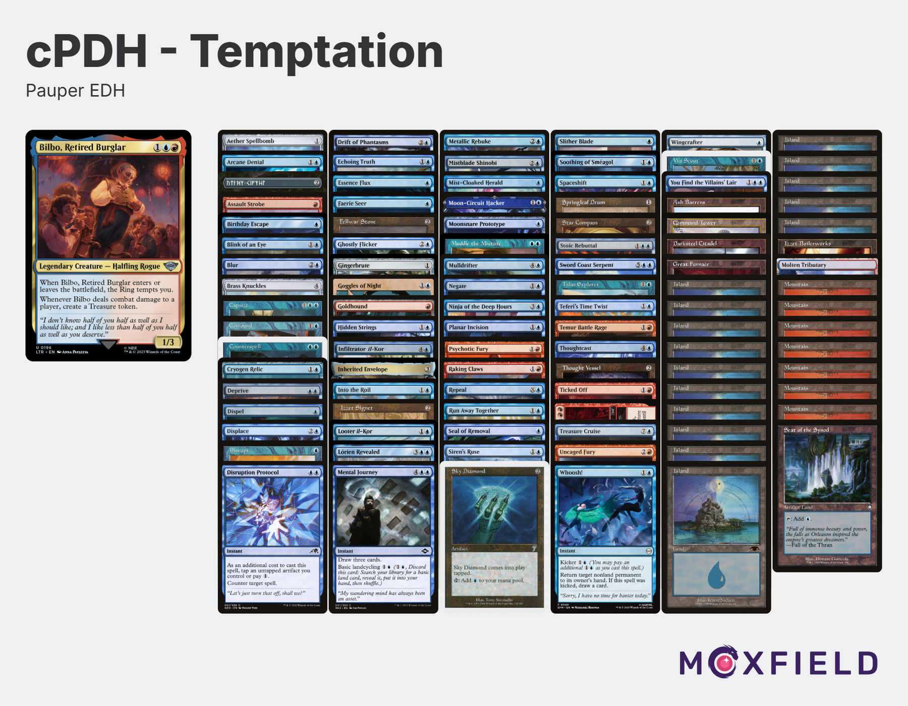

With the Hobbit MTG set release upon us, I was disappointed to find no sparkly new Pauper Commanders that look ready to hit the competitive scene. There are some fun commanders, don't get me wrong, but nothing I think is ready to win a tournament.

With that in mind, I decided to revisit one of my favorite characters from The Hobbit — one with some sentimental value for me in cPDH: [[Bilbo, Retired Burglar]]. This was my first deck I brought to a tournament and even made top 4 with it!



## The Gameplan

Because Bilbo tempts you on both entering and leaving the battlefield, it's simple to flicker him and reach full temptation in just a few turns. The unique gameplan for Bilbo is to then use that full temptation to push damage across the whole table, having my opponents lose 3 life each time my ring-bearer connects with any one opponent.



I already run the flicker cards, and in theory you could build a version of this deck that aims to flicker combo with those same pieces, giving you two pathways to victory. But there are already so many commanders better suited to flicker combo. Bilbo's much better off focusing on what it does best - the temptation mechanic.

Bilbo himself brings a Batman utility belt of tools to my gameplan. Printed on his card, he ramps me with a Treasure each turn. On top of that, the Ring grants skulk (temptation level 1), looting to cycle into the cards I want (temptation level 2), and a 9 lost life across the board on each instance of combat damage from my ring bearer (temptation level 4). He's very nifty in providing all of these at once.



## How This Guide Works

Some commanders have a clear, linear path to optimization — versions that are just better, cards that are just stronger. Bilbo is not one of them. There is no single best version of this deck.

So this guide splits into an exploration of packages: the core every build needs, then a mix-and-match section where you choose the elements you want most and assemble them your way. You can lean into combat damage synergies, pingers, or control.

For context: my initial decklist was heavy on pingers and control pieces — I prefer the controlling version, since it takes time to get repeated pinger damage through. My current list has shifted a lot, reducing pingers to focus on the temptation mechanic while keeping a strong emphasis on control.



## The Core

These two packages are non-negotiable — every Bilbo build runs them.

### Flicker

Bilbo gets me my first temptation trigger on cast. Flicker gets me the next two. In addition, ninjutsu cards are pretty neat here, letting me return Bilbo to hand for additional triggers on return and on re-cast. I can later use these cards to swap my ring-bearers mid-combat and sneak damage through. 



### Temptation

I run these to land the fourth temptation trigger with ease. When they're not available, I can always flicker Bilbo again.





## Pick and Choose

Here's the mix-and-match section. Take the packages that fit the version you want to pilot. Part of the choice you need to make is how many slots of each effect/category to fill. Of late, I've decided to go way more focused on the combat damage, throwing more double strike and combat damage effects into the deck. Maybe you want the best double strike, but not all eight cards that I've elected to run. Reflect on how you want to win with your version of the deck and pick the cards that best support your plan. 

### Evasive Creatures

With skulk available from my commander, you don't *need* small evasive creatures — but I still run about a dozen of my favorites so I don't have to depend on Bilbo alone. Several of these creatures offer small buffs along the way, like scrying or peeking effects to inform my play. 



### Pingers

My first build leaned on noncreature control spells plus a stack of pingers, letting my control spells also push the game toward an end state through pinged damage. You can run a whole bunch of pingers alongside Bilbo to damage the table nonstop, pushing your opponents toward death turn after turn. I think this is a great idea — and if you love pingers, you should consider the curiosity package below.



### Curiosity Effects

These are super strong with pingers, and the ones that draw cards can flat-out win you the game: paired with [[Magmakin Artillerist]] and more than seven cards in hand, you trigger a discard-until-you-win loop during your cleanup step. Even without the instant win, you get lots of extra damage and draw as your looting effects discard cards each time you attack.



### Tutors

If you go the combo route (and I think the Magmakin combo fits very well here), tutors find your pieces faster — and your utility pieces in a pinch.



### Double Strike

Since I'm winning through a combat-damage-enabled strategy, double strike gives me two combat damage triggers each time I connect — turning a 10-damage output into 20 per turn from the ring, drawing off of my curiosity effects, or getting additional triggers from Goggles of Night or Hidden Strings.



### Control Pieces

Fill your deck with your favorite and preferred counterspells and removal. It takes time to win with temptation triggers, so controlling the game and preventing opponents from winning buys the time to close it out.



### Additional Combat Damage Effects

Since I'm using evasion to get damage through, why not stack more effects from my combat damage? The curiosity effects above apply to this section too. Also worth considering here: effects that grant the initiative or the monarchy, which my evasive attackers can take back from my opponents time and again.



## Playing Against This Deck

Bilbo is very creature-focused and will suffer against heavy control decks or strong board wipe decks (hello [[Crypt Rats]]). One of the things that makes it resilient, however, is how sticky the Ring Emblem is once it's on the battlefield. There's no way to remove it. This makes the focus of the deck pretty difficult to interact with. The deck requires the commander to be available to flicker or cast to declare a ring-bearer. 

## Conclusion

I've had a great deal of fun with this deck and I'm back to trying to refine the list to its best, most effective version. It's a slower, unique deck and I'm excited to keep playing this deck until I can top 4 with it again. 

I hope you check it out, and if you're tempted to try Bilbo, Retired Burglar out for yourself, you can use the link below to purchase the deck straight from Manapool. Happy Hobbiting!

<a href="https://manapool.com/add-deck?deck=MSBBZXRoZXIgU3BlbGxib21iCjEgQXJjYW5lIERlbmlhbAoxIEFyY2FuZSBTaWduZXQKMSBBc2ggQmFycmVucwoxIEFzc2F1bHQgU3Ryb2JlCjEgQmlydGhkYXkgRXNjYXBlCjEgQmxpbmsgb2YgYW4gRXllCjEgQmx1cgoxIEJyYXNzIEtudWNrbGVzCjEgQ2Fwc2l6ZQoxIENvbW1hbmQgVG93ZXIKMSBDb25mb3VuZAoxIENvdW50ZXJzcGVsbAoxIENyeW9nZW4gUmVsaWMKMSBEYXJrc3RlZWwgQ2l0YWRlbAoxIERlcHJpdmUKMSBEaXNwZWwKMSBEaXNwbGFjZQoxIERpc3J1cHQKMSBEaXNydXB0aW9uIFByb3RvY29sCjEgRHJpZnQgb2YgUGhhbnRhc21zCjEgRWNob2luZyBUcnV0aAoxIEVzc2VuY2UgRmx1eAoxIEZhZXJpZSBTZWVyCjEgRmVsbHdhciBTdG9uZQoxIEdob3N0bHkgRmxpY2tlcgoxIEdpbmdlcmJydXRlCjEgR29nZ2xlcyBvZiBOaWdodAoxIEdvbGRob3VuZAoxIEdyZWF0IEZ1cm5hY2UKMSBIaWRkZW4gU3RyaW5ncwoxIEluZmlsdHJhdG9yIGlsLUtvcgoxIEluaGVyaXRlZCBFbnZlbG9wZQoxIEludG8gdGhlIFJvaWwKMTUgSXNsYW5kCjEgSXp6ZXQgQm9pbGVyd29ya3MKMSBJenpldCBTaWduZXQKMSBMb290ZXIgaWwtS29yCjEgTMOzcmllbiBSZXZlYWxlZAoxIE1lbnRhbCBKb3VybmV5CjEgTWV0YWxsaWMgUmVidWtlCjEgTWlzdC1DbG9ha2VkIEhlcmFsZAoxIE1pc3RibGFkZSBTaGlub2JpCjEgTW9sdGVuIFRyaWJ1dGFyeQoxIE1vb24tQ2lyY3VpdCBIYWNrZXIKMSBNb29uc25hcmUgUHJvdG90eXBlCjcgTW91bnRhaW4KMSBNdWRkbGUgdGhlIE1peHR1cmUKMSBNdWxsZHJpZnRlcgoxIE5lZ2F0ZQoxIE5pbmphIG9mIHRoZSBEZWVwIEhvdXJzCjEgUGxhbmFyIEluY2lzaW9uCjEgUHN5Y2hvdGljIEZ1cnkKMSBSYWtpbmcgQ2xhd3MKMSBSZXBlYWwKMSBSdW4gQXdheSBUb2dldGhlcgoxIFNlYWwgb2YgUmVtb3ZhbAoxIFNlYXQgb2YgdGhlIFN5bm9kCjEgU2lyZW4ncyBSdXNlCjEgU2t5IERpYW1vbmQKMSBTbGl0aGVyIEJsYWRlCjEgd2hvb3NoCjEgU29vdGhpbmcgb2YgU23DqWFnb2wKMSBTcGFjZXNoaWZ0CjEgU3ByaW5nbGVhZiBEcnVtCjEgU3RhciBDb21wYXNzCjEgU3RvaWMgUmVidXR0YWwKMSBTd29yZCBDb2FzdCBTZXJwZW50CjEgVGFsYXMgRXhwbG9yZXIKMSBUZWZlcmkncyBUaW1lIFR3aXN0CjEgVGVtdXIgQmF0dGxlIFJhZ2UKMSBUaG91Z2h0IFZlc3NlbAoxIFRob3VnaHRjYXN0CjEgVGlja2V0IEJvb3RoL1R1bm5lbCBvZiBIYXRlCjEgVHJlYXN1cmUgQ3J1aXNlCjEgVW5jYWdlZCBGdXJ5CjEgV2luZ2NyYWZ0ZXIKMSBXdSBTY291dAoxIFlvdSBGaW5kIHRoZSBWaWxsYWlucycgTGFpcgoKMSBCaWxibywgUmV0aXJlZCBCdXJnbGFy&ref=cpdhguide" class="btn btn--primary btn--large" target="_blank" rel="noopener">Purchase on Manapool</a>




